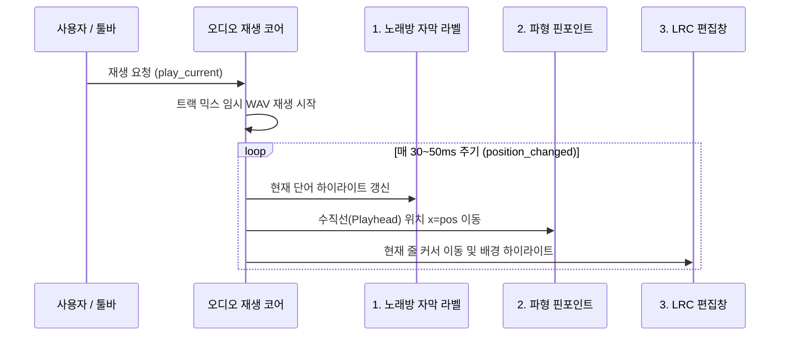

# 오디오 편집기 메인 창 통합 기획서

| 항목 | 내용 |
|---|---|
| 문서 버전 | v1.2 (재생 엔진 단일화 및 3중 실시간 동기화 확정 반영) |
| 작성일 | 2026-11-02 |
| 갱신일 | 2026-11-02 |
| 기준 커밋 | `11dc3e4 feat(audio_editor): 자막 줄·단어 드래그와 LRC 실시간 동기화` |
| 대상 | `audio_editor.py` (약 2,070줄), `karaoke_gui.py` (약 1,257줄) |
| 상태 | 기획 수정 완료 / 구현 준비 |

---

## 1. 목표

오디오 편집기를 **별도 창(모달 다이얼로그)** 으로 띄우지 않고 메인 화면 안에 통합하며, **재생 엔진을 오디오 편집기 방식으로 완전히 통일**한다.

- 메인 창과 오디오 편집기로 나뉘어 있던 재생기를 **오디오 편집기의 실시간 믹스 재생 엔진으로 완전 일원화**하여 중복 코드를 제거한다.
- 메인 화면에서 재생 시 다음 **3가지 화면이 오차 없이 동시에 실시간 동기화**된다:
  1. **노래방 자막 미리보기**: 단어/음절 단위로 색상이 바뀌며 가사 표시 (`preview_lyric_label`)
  2. **파형 그래프 핀포인트**: 오디오 재생 위치를 나타내는 수직 플레이헤드가 파형 위에서 동시 이동
  3. **LRC 입력/편집창**: 현재 재생 중인 가사 줄로 텍스트 커서가 자동 이동하고 배경색 하이라이트
- 파형과 LRC 편집창을 한 화면에서 보면서 싱크를 확인하고, 자막 드래그 결과가 LRC에 즉시 반영된다.
- 트랙 볼륨·M/S, 구간 자르기, 페이드, 정규화, 믹스 저장을 메인 화면에서 원스톱으로 처리한다.

### 성공 기준

1. 메인 창 재생 버튼 하나로 **노래방 자막 라벨 + 파형 핀포인트 + LRC 줄 커서/색상**이 동시에 완벽하게 동기화된다.
2. 기존 메인 창의 중복된 오디오 재생 코드(`_player`, `preview_play`, `preview_stop` 등)를 완전히 걷어내고 코드를 단순화한다.
3. 파형에서 자막 줄/단어 드래그 시 메인 창 LRC가 실시간 갱신된다.
4. 오디오 편집 기능(트림, 정규화, 페이드, 믹스, 저장)이 단일 창에서 정상 동작한다.
5. 전환 과정에서 기존 모달 다이얼로그는 단계 3까지 fallback/팝아웃 래퍼로 안전하게 유지된다.

---

## 2. 범위

### 포함

- 메인 창 레이아웃 통합 (설정 접이식 + 공통 툴바 + 노래방 자막 스트립 + 파형 패널 + 가사/LRC QSplitter)
- `AudioEditorDialog` → `AudioEditorPanel` 모듈화 및 `audio_editor/` 패키지 구조화
- **재생 엔진 완전 통일**: 오디오 편집기의 실시간 믹스 재생(`_build_playback_data`) 방식을 단일 재생 코어로 채택
- **3중 실시간 동기화 파이프라인**: `position_changed` 시그널로 (1) 노래방 라벨, (2) 파형 핀포인트, (3) LRC 줄 하이라이트 동시 제어
- **양방향 선택 연동**: LRC 줄 클릭 ↔ 파형 위치 이동 (동기화 무한 루프 방지 잠금 플래그 적용)
- 창 크기, 분할 비율, 접힘 상태 설정 저장

### 제외

- STT / 음성 정렬(Alignment) 백엔드 알고리즘 변경
- 파형 렌더링 라이브러리(`pyqtgraph`) 대체
- 잡음 제거(Denoise) 내부 처리 알고리즘 변경
- 서버 모델 관리 및 VRAM 설정 로직 변경

---

## 3. 현재 구조와 개선 방향

### 현재 구조의 문제점

```
[현재: 2개의 창, 2개의 독립 재생기]

메인 창 (karaoke_gui.py)
├─ PreviewSection: 자체 QMediaPlayer (원본 파일 직접 스트리밍)
│   └─ 가사 색상 라벨 + 재생/정지 + 슬라이더 + LRC 줄 하이라이트
└─ LyricsSection: 원본 가사 | LRC 편집창

오디오 편집기 (audio_editor.py - 모달 다이얼로그)
├─ 자체 QMediaPlayer (트랙 볼륨·M/S 반영된 임시 WAV 파일 생성 재생)
├─ 파형 3개 + 플레이헤드 핀포인트 + 자막 레인
└─ 구간 편집 및 믹스 저장
```

1. **재생기 중복 및 소리 겹침**: 두 곳에서 각각 `QMediaPlayer`를 생성하여 재생 상태가 꼬이거나 소리가 겹침.
2. **기능 단절**: 메인 창 재생기는 오디오 편집기의 트랙 볼륨이나 M/S, 구간 편집 결과를 들을 수 없음.
3. **모달 창의 고립**: 파형을 보면서 메인 화면의 LRC 텍스트를 직접 편집할 수 없음.
4. **거대한 단일 파일**: `audio_editor.py`가 2,000줄이 넘어 유지보수와 확장이 어려움.

### 개선 구조: 단일 화면 + 단일 재생 엔진

```
[개선: 단일 창, 단일 재생 엔진, 3중 동기화]

메인 창 (MainWindow)
├─ 상단 메뉴바 & 접이식 설정 헤더
├─ 공통 툴바: 파일 열기 / 통합 재생 제어 / 템포 / 오프셋
├─ 노래방 1줄 미리보기 라벨 (28px 컴팩트 스트립) ─────────┐ [1. 노래방 자막]
├─ AudioEditorPanel (QSplitter 상단)                       │
│   ├─ 단일 재생 코어 (트랙 믹스 기반 임시 WAV 재생)       │
│   │   └─ position_changed(pos_sec, total_sec) 시그널 ───┼─ [2. 파형 핀포인트]
│   └─ 파형 트랙 1/2/3 + 핀포인트 + 자막 드래그 레인        │
└─ LyricsSection (QSplitter 하단)                          │
    ├─ 좌: 원본 가사 텍스트                                │
    └─ 우: Enhanced LRC 편집창 ────────────────────────────┘ [3. LRC 줄/커서]
```

---

## 4. 최종 화면 설계

### 4.1 전체 레이아웃

```
┌──────────────────────────────────────────────────────────────────────────────┐
│ 파일   편집   보기   도구   도움말                          서버 ● 정상       │
├──────────────────────────────────────────────────────────────────────────────┤
│ [오디오 열기] [보컬 열기] │ [▶ 재생] [■ 정지] 00:12.34/03:45 │ 1.0x [-] [+] │
│ 맞춤: [선택 줄 맞춤] [전체 줄 맞춤] │ [자동 오프셋] [오프셋 적용] │ 설정 ▼   │
├──────────────────────────────────────────────────────────────────────────────┤
│ [노래방 미리보기]  이 밤이 <지나면> 그대를 떠나야 하네 (현재 단어 하이라이트)  │ ← 28px
├──────────────────────────────────────────────────────────────────────────────┤
│ 반주(Track 1)   볼륨 ──●──  [M] [S]                                          │
│ ┌──────────────────────────────────────────────────────────────────────────┐ │
│ │                  파형 (Waveform)  │ (핀포인트 플레이헤드 실시간 이동)     │ │
│ ├──────────────────────────────────┴───────────────────────────────────────┤ │
│ │ [00:12.34] 첫 번째 자막 줄   [00:14.80] 두 번째 자막 줄 ...             │ │
│ │ 첫 번째 │ 자막 │ 줄 │ ...          ← 단어별 드래그 레인                 │ │
│ └──────────────────────────────────────────────────────────────────────────┘ │
│ 보컬(Track 2)   볼륨 ──●──  [M] [S]                                          │
│ ┌──────────────────────────────────────────────────────────────────────────┐ │
│ │                  파형 (Waveform)                                         │ │
│ └──────────────────────────────────────────────────────────────────────────┘ │
│ 믹스(Track 3)  [접기 ▼]                                                      │
├──────────────────────────────────────────────────────────────────────────────┤
│ 구간 편집: [구간만 남기기] [삭제] [정규화] [페이드] │ [반복 재생] [믹스 저장] │
├──────────────────────────────────────────────────────────────────────────────┤
│ 원본 가사                                 │ LRC 편집 (Enhanced LRC)         │
│ ┌───────────────────────────────────────┐ │ ┌─────────────────────────────┐ │
│ │                                       │ │ │ [00:12.34]<00:12.34>이 밤이...│ │ ← 커서/색상
│ └───────────────────────────────────────┘ │ └─────────────────────────────┘ │
│ [타이밍 생성] [적용] [비교] [되돌리기]                                       │
├──────────────────────────────────────────────────────────────────────────────┤
│ 상태: 재생 중 12.34초 · LRC 25줄 · 선택 1.20~3.40초                          │
└──────────────────────────────────────────────────────────────────────────────┘
```

### 4.2 세로 높이 배분 (1280 × 840 기준, 반응형 최적화)

| 영역 | 높이(px) | 비고 |
|---|---|---|
| 메뉴바 & 설정 헤더(접힘) | 32 | 아코디언 토글 시 120px로 확장 |
| 공통 툴바 | 40 | 재생/정지, 시간, 속도, 오프셋 조절 |
| **노래방 1줄 미리보기 라벨** | **28** | 단어별 색상 하이라이트 전용 스트립 |
| **파형 편집 패널 (Track 1 & 2)** | **340** | 자막 레인, 핀포인트, 얇은 구간 편집 바 포함 |
| **가사 / LRC 편집창 (2열)** | **360** | QSplitter로 파형과 높이 자유 조절 가능 |
| 상태 표시줄 | 24 | 실시간 위치, 줄 수, 안내 문구 |
| **총합** | **824** | **840px 기준에 안정적으로 안착 (노트북 768px 호환)** |

- 파형 패널과 가사 섹션 사이는 **QSplitter(세로)** 로 배치하여 사용자가 원하는 대로 높이를 조절할 수 있습니다.
- 작은 화면(768px)에서는 [파형 접기] 버튼을 통해 가사 편집창을 최대화할 수 있습니다.

---

## 5. 상호작용 및 3중 동기화 설계

### 5.1 통합 재생 시 3중 동기화 파이프라인

메인 창의 [재생] 버튼이나 단축키를 누르면 **오디오 편집기 재생 코어가 실행**되며, 매 타이머/위치 업데이트 주기(약 30~50ms)마다 단일 이벤트로 3개 뷰를 동시에 갱신합니다:



1. **미리보기 화면 (노래방 자막)**:
   - 현재 재생 위치(초 단위)를 기준으로 파싱된 단어 목록에서 `<시작시간> ~ <종료시간>`을 매칭합니다.
   - 지난 단어(`past`), 현재 부르는 단어(`current`, 밑줄/굵게), 다가올 단어(`future`)로 HTML 색상 서식을 입혀 라벨에 실시간 출력합니다.
2. **파형 그래프 핀포인트**:
   - `_SelectablePlot` 위에 생성된 `InfiniteLine`(수직선)의 x좌표를 현재 재생 시간으로 실시간 갱신합니다.
   - 재생 위치가 화면 밖으로 벗어나면 필요에 따라 파형을 부드럽게 자동 스크롤(Auto Pan)합니다.
3. **LRC 입력/편집창**:
   - 현재 재생 중인 시간대의 줄 번호(`line_index`)를 계산합니다.
   - 해당 줄의 텍스트 블록에 하이라이트 배경색(`current` 색상)을 입히고, 텍스트 커서를 해당 줄로 이동하여 자동 스크롤(`ensureCursorVisible`)합니다.

### 5.2 양방향 선택 연동 및 이벤트 잠금

| 사용자 조작 | 연동 결과 | 안전장치 (무한 루프 방지) |
|---|---|---|
| **LRC 편집창의 줄 클릭** | 파형 시간으로 이동 + 핀포인트 이동 + 해당 자막 블록 강조 | `_is_syncing` 플래그로 파형의 선택 이벤트가 다시 LRC 커서를 건드리지 않도록 차단 |
| **파형 자막 블록 클릭** | LRC 편집창의 해당 줄로 커서 이동 및 뷰 스크롤 | `_is_syncing` 플래그 적용 |
| **자막 줄/단어 드래그** | 약 50ms 간격으로 LRC 편집창 실시간 텍스트 갱신 | 드래그 중에는 LRC의 `textChanged` 무거운 파싱을 일시 디바운스 처리 |

### 5.3 단축키 규칙

| 키 | 텍스트 입력창 포커스 시 | 파형 / 일반 영역 포커스 시 |
|---|---|---|
| **Space** | 공백(띄어쓰기) 입력 | 오디오 재생 / 일시정지 토글 |
| **Ctrl + Space** | **오디오 재생 / 일시정지 (글로벌)** | **오디오 재생 / 일시정지 (글로벌)** |
| **← / →** | 텍스트 커서 이동 | 오디오 위치 5초 뒤로 / 앞으로 이동 |
| **Delete** | 글자 삭제 | 파형 선택 구간 묵음/삭제 |
| **Ctrl + Z** | 텍스트 실행 취소 | 파형 편집 실행 취소 |

---

## 6. 모듈화 및 코드 구조

### 6.1 패키지 디렉터리 구조

`audio_editor.py` 단일 파일을 아래와 같이 깔끔하게 분리합니다:

```
audio_editor/
  __init__.py          # AudioEditorPanel, AudioEditorDialog 노출
  track_worker.py      # 오디오 비동기 로드 스레드 (_LoadTrackWorker)
  waveform.py          # 파형 렌더링 및 마우스 선택 (_SelectablePlot) - 시그널 기반 디커플링
  subtitle_lane.py     # 자막 줄/단어 드래그 레인 (_SubtitleLane)
  playback_engine.py   # 트랙 믹스, 임시 버퍼 생성, 단일 QMediaPlayer 제어 코어
  panel.py             # AudioEditorPanel(QWidget): 파형 + 재생 + 툴바 통합 패널
  dialog.py            # AudioEditorDialog(QDialog): 팝아웃 및 하위 호환용 래퍼
```

### 6.2 위젯 간 시그널 기반 디커플링

기존 `_SelectablePlot`이 `self.dialog`를 직접 호출하던 결합을 제거하고 표준 시그널로 변경합니다:

- `_SelectablePlot`:
  - `time_clicked = Signal(float)`: 파형 클릭 시 시간 전달
  - `range_selected = Signal(float, float)`: 구간 드래그 선택 시 전달
  - `delete_requested = Signal()`: Delete 키 입력 시 전달
- `AudioEditorPanel`:
  - 위 시그널들을 연결받아 내부 재생 엔진 및 트랙 데이터를 제어
  - 외부에 `position_changed = Signal(float, float)` (현재시간, 전체시간) 방출
- `MainWindow`:
  - `position_changed` 시그널 하나만 받아 **노래방 라벨 갱신**과 **LRC 줄 하이라이트**를 동기화

---

## 7. 단계별 구현 계획

각 단계는 완료 후 구문 검사(`py_compile`) 및 앱 동작 검증을 거친 뒤 커밋합니다.

### 단계 0 — 기준선 확인
- 현재 상태에서 앱 실행, 오디오 열기, 자막 드래그, 메인 화면 동작 확인
- 백업 기준선 점검

### 단계 1 — `audio_editor/` 패키지 원자적 전환
- `audio_editor.py`를 `audio_editor/` 패키지로 전환
- `__init__.py`에서 기존 API(`AudioEditorDialog`, `open_track`, `set_lrc_text` 등)를 그대로 재노출하여 기존 `karaoke_gui.py`와의 호환성 100% 유지
- **검증**: 앱 실행 및 기존 오디오 편집기 열림 확인

### 단계 2 — 위젯 분리 및 디커플링
- `waveform.py` (`_SelectablePlot`), `subtitle_lane.py` (`_SubtitleLane`), `track_worker.py` 분리
- `_SelectablePlot`의 `self.dialog` 직참조를 시그널(`time_clicked`, `range_selected` 등)로 리팩토링
- **검증**: 파형 선택, 확대/축소, 자막 줄/단어 드래그 정상 동작 확인

### 단계 3 — `AudioEditorPanel` 및 재생 코어 추출
- `playback_engine.py`로 오디오 믹스 재생 엔진을 독립 모듈화
- `panel.py`에 `AudioEditorPanel(QWidget)` 구현 (외부로 `position_changed`, `lrc_updated` 시그널 노출)
- `dialog.py`는 `AudioEditorPanel`을 내부에 얹은 얇은 래퍼로 단순화
- **검증**: 다이얼로그 방식으로 열었을 때 재생/정지/트랙 믹스 정상 동작 확인

### 단계 4 — 메인 창 재생 코드 정리 (중복 코드 제거)
- `karaoke_gui.py` 내의 구형 재생 코드(`self._player`, `self._audio_output`, `preview_play()`, `preview_pause()`, `preview_stop()`) 완전 제거
- 메인 툴바의 재생/정지/슬라이더 제어를 오디오 편집기의 재생 엔진으로 연결
- **검증**: 메인 창에서 재생 시 단일 엔진을 통해 소리가 정상 출력되는지 확인

### 단계 5 — 메인 화면에 `AudioEditorPanel` 삽입 및 3중 동기화 연결
- 메인 창 세로 레이아웃을 `[설정 접이식] → [공통 툴바] → [노래방 자막 스트립] → [파형 패널] → [가사/LRC 섹션]` 순으로 QSplitter 배치
- `AudioEditorPanel.position_changed` 시그널을 메인 창에 연결:
  1. 노래방 라벨 실시간 가사 색상 갱신
  2. 파형 핀포인트 이동 (패널 내부 처리)
  3. LRC 편집창 현재 줄 커서 이동 및 하이라이트
- **검증**: 재생 시 3가지 화면이 동시에 오차 없이 움직이는지 확인

### 단계 6 — 양방향 선택 연동 및 마무리
- LRC 편집창 줄 클릭 → 파형 시간 이동 연동
- 파형 자막 블록 클릭 → LRC 줄 선택 연동
- 이벤트 무한 루프 방지 잠금 플래그(`_is_syncing`) 적용
- 창 크기 및 스플리터 비율 `settings.json` 저장/복원
- **검증**: 양방향 클릭 연동, 장시간 재생 안정성, 1024×720 해상도 확인

---

## 8. 위험 관리

| 위험 요소 | 영향 | 해결 및 예방책 |
|---|---|---|
| **위젯 분리 시 결합도 에러** | `AttributeError: dialog` 발생 | 단계 2에서 `self.dialog` 참조를 완전 제거하고 PySide6 Signal로 대체 |
| **양방향 연동 시그널 루프** | UI 멈춤 / 버벅임 | `_is_syncing` 플래그로 한쪽에서 발생한 위치 이동 중 반대편 트리거 차단 |
| **임시 WAV 파일 누적** | 디스크 낭비 | 재생 엔진 정지(`stop`) 및 앱 종료(`closeEvent`) 시 이전 임시 파일 즉시 청소 |
| **작은 화면 세로 잘림** | 가사창이나 파형이 찌그러짐 | 노래방 라벨 28px화, 구간 편집 바 1줄화, 파형 영역 접기 토글 제공 |
| **단축키 오동작** | 가사 수정 중 Space로 음악 정지 | 텍스트 포커스 시 Space는 띄어쓰기로 격리, 전역 재생은 `Ctrl+Space` 제공 |

---

## 9. 완료 기준 (Acceptance Criteria)

- [ ] 메인 창에서 오디오를 열면 파형이 즉시 로드된다.
- [ ] 메인 창의 [재생] 버튼 클릭 시 오디오가 재생된다. (기존 구형 플레이어 완전 대체)
- [ ] **[3중 동기화 1]** 노래방 라벨에 현재 재생 단어가 실시간 색상으로 표시된다.
- [ ] **[3중 동기화 2]** 파형 위 핀포인트(수직선)가 음악과 일치하여 부드럽게 이동한다.
- [ ] **[3중 동기화 3]** LRC 편집창에서 현재 재생 중인 줄에 하이라이트가 들어가고 커서가 따라 이동한다.
- [ ] 자막 레인에서 줄/단어를 드래그하면 LRC 편집창 텍스트가 실시간으로 갱신된다.
- [ ] LRC 편집창의 특정 줄을 클릭하면 해당 시간으로 파형 핀포인트가 즉시 이동한다.
- [ ] 파형 자막 블록을 클릭하면 LRC 편집창의 해당 줄이 선택되고 스크롤된다.
- [ ] 트랙 볼륨 조절, M/S, 구간 편집(트림, 정규화, 페이드), 믹스 저장이 정상 작동한다.
- [ ] 1024×720 해상도에서 화면 요소가 겹치거나 잘리지 않는다.
- [ ] 앱 종료 시 남은 임시 오디오 파일이 깨끗이 삭제된다.
